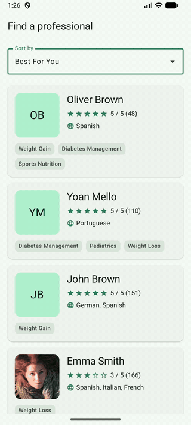
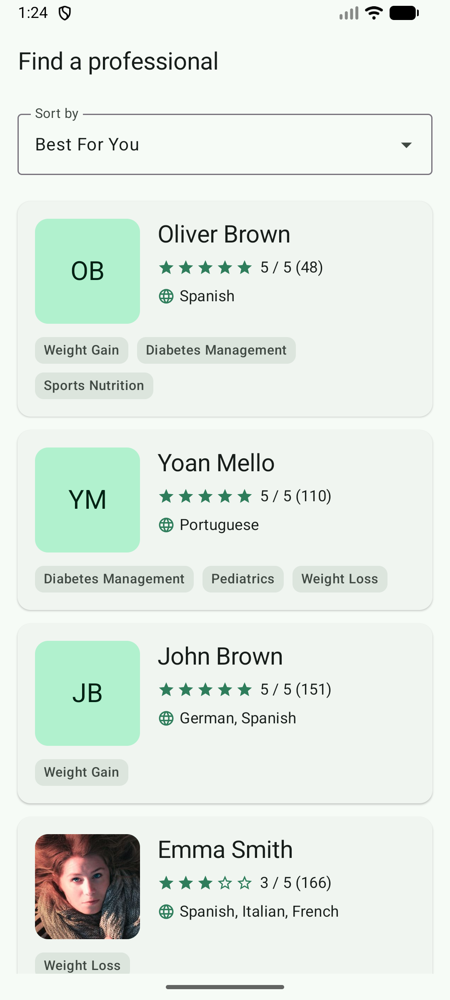
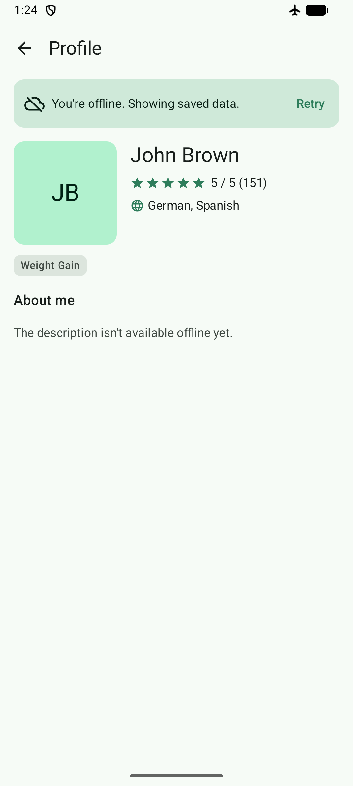
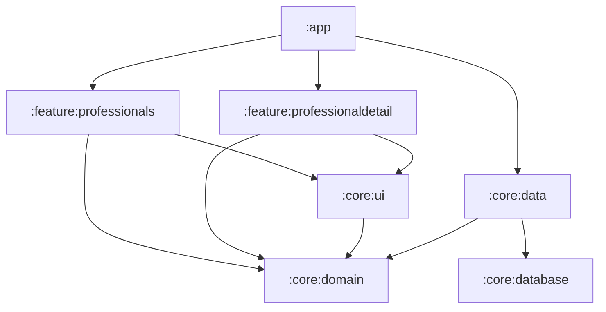

# NutriSearch

An Android app to search nutrition professionals, sort the results and open a professional's profile. It works offline: everything already seen stays available without a connection.

| Demo | Search | Profile | Offline |
|---|---|---|---|
|  |  |  |  |

## Features

**Requested**
- Search list with offset-based pagination (`limit` / `offset`)
- Sort by Best For You, Rating and Most Popular
- Profile screen with "About me"; "Show more" appears only when the text overflows
- Offline support: the list and profiles already loaded are shown without a connection

**Extras**
- Cache first: cached data is shown at once and refreshed in the background
- Pull to refresh on the list, Retry on the profile when a refresh fails
- A banner over cached data when a refresh fails, with a message per cause: "You're offline" for no connection, "Couldn't update" for server and other errors
- Item animations when the sort changes, and scroll to top once the new results arrive
- Initials as a fallback when a profile picture fails to load (some API images return 404)
- Light and dark themes

## How to run

Requirements: Android Studio with support for AGP 9.4, JDK 17. minSdk 28, compileSdk 37.

```bash
./gradlew assembleDebug
```

Tests:

```bash
# JVM unit tests (API, mappers, formatters, ViewModels)
./gradlew testDebugUnitTest

# Instrumented tests (RemoteMediator with an in-memory Room database); needs an emulator or device
./gradlew :core:data:connectedDebugAndroidTest
```

The API base URL (`https://nutrisearch.vercel.app/`) is set as a `BuildConfig` field in `:core:data`. No keys or local configuration are needed.

## Architecture



| Module | Responsibility |
|---|---|
| `:app` | Composition root: starts Koin, owns the `NavHost` and wires navigation between features |
| `:feature:professionals` | Search list: ViewModel, screen, sort, paging UI |
| `:feature:professionaldetail` | Profile screen |
| `:core:domain` | Pure Kotlin: models, `AppError`, `ProfessionalRepository` interface |
| `:core:data` | Ktor API, DTOs, mappers, `RemoteMediator`, repository implementation |
| `:core:database` | Room database, entities and DAOs (the only module running KSP) |
| `:core:ui` | Theme and shared components (summary, avatar, rating, banners, loading / error views) |
| `:core:testing` | `FakeProfessionalRepository`, fixtures, `MainDispatcherRule` |

**Dependency rules.** Features depend only on `:core:domain` and `:core:ui`, never on each other or on `:core:data`. Only `:app` knows both features: the list exposes an `onProfessionalClick` callback and `:app` connects it to the profile route.

**Data flow.** Room is the single source of truth. The UI only reads Room; the network only writes to Room.

```
API ──► RemoteMediator / refreshProfessional ──► Room ──► Flow / PagingSource ──► ViewModel ──► Compose
```

**Presentation.** MVI per screen: one immutable `State`, user actions as `Intent`s sent to `onIntent`. Each screen is split into a `Route` (gets the ViewModel, collects state) and a stateless `Screen` (rendered in previews). Navigation callbacks go from the nav graph to the screen and do not pass through the ViewModel.

## Decisions and trade-offs

**Offline and caching**
- **Room as the single source of truth.** Gives offline support and instant data on reopen with one code path. Cost: a database layer for a small API.
- **Tables.** `professionals` (one row per professional, shared by every sort and the profile), `search_results(sort_by, position, professional_id)` (the order of each sort) and `remote_keys(sort_by, next_offset, last_updated)`. Sorts never overwrite each other, and a list refresh never erases an `about_me` already fetched (partial upsert of the summary columns).
- **One `RemoteMediator` per sort.** REFRESH loads offset 0 and replaces only that sort's results; APPEND continues from `next_offset`. Writes happen in one transaction after the network call, so an offline refresh never clears the cache.
- **Cache timeout of 10 minutes.** `initialize()` skips the initial refresh when the cached results are recent. Pull to refresh always goes to the network.
- **Duplicates.** Offset paging can return the same professional twice if the server order shifts between pages. The paging query groups by id and keeps the first position, because duplicate keys crash a `LazyColumn`.
- **Profile is cache first.** A professional seen in the list opens at once with its summary; `about_me` loads in the background. `null` means "not loaded yet", an empty string means "loaded, no description".

**Paging**
- **`pageSize = 4`**, the API default. With only 10 professionals, a bigger page would hide the pagination.
- **`PagingData` in the domain**, through `paging-common` (pure Kotlin). Trade-off: the domain knows a paging type, in exchange for no wrapper around paging.

**Presentation**
- **The profile ViewModel exposes a sealed state** (`Loading` / `Error` / `Content`). Impossible combinations cannot be represented, and the screen rules are covered by ViewModel tests.
- **The list's screen state is mapped in the UI** (`ListContent`) because paging load states live in `LazyPagingItems`, on the UI side. Moving them into the ViewModel would mean recreating the pager there.
- **Sort lives in `SavedStateHandle`**, so it survives process death. Both the UI state and the pager derive from it. The profile id is an immutable argument and enters the ViewModel through its constructor (restored by Navigation).
- **Scroll to top on sort change** waits for the new results: `LazyColumn` keeps the first visible item's key in view when data changes, so scrolling at click time would be undone. Waiting keeps the item animations.
- **Repeated taps** are ignored by only acting while the screen's back stack entry is `RESUMED`.

**Errors**
- **`AppError`** (`NoConnection`, `NotFound`, `Server`, `Unknown`) is mapped from Ktor and IO exceptions in `:core:data` and turned into text in `:core:ui` with exhaustive `when`s: a new error type does not compile until it has a message.
- **Two kinds of error message.** A full-screen error appears when there is nothing to show; `StaleDataBanner` appears over cached data, so its text says the saved data is still shown. The banner only says "offline" for `NoConnection`: a server error with the network on should not send the user to check their Wi-Fi.

**Libraries**
- **Koin** over Hilt: less setup and faster builds for a project this size. Trade-off: the graph is checked at runtime, not at compile time.
- **Ktor** with kotlinx.serialization, **Coil 3** for images, **Navigation Compose** with type-safe routes.

## Testing

| What | Where | How |
|---|---|---|
| API (query params, parsing, 404) | `:core:data` unit tests | Ktor `MockEngine` |
| Mappers, rating formatter | unit tests | plain JUnit |
| ViewModels | feature unit tests | `FakeProfessionalRepository` (a fake, not a mock), `MainDispatcherRule`, `paging-testing` |
| RemoteMediator (page order, end of list, offline refresh keeps the cache) | `:core:data` instrumented tests | in-memory Room, fake server built on `MockEngine` |

The mediator tests are instrumented because the Room testing guide recommends real devices over Robolectric, and running Room on the JVM would need Room KMP.

## Known limitations and next steps

- Unit tests for `listContent()` and Compose UI tests
- Convention plugins (`build-logic`) to remove the repeated Gradle setup
- A `:core:network` module once there are more endpoints
- Room KMP, to run the database tests on the JVM
- `Koin.verify()` test to check the dependency graph at test time
- CI (build, tests, lint)
- Cursor-based pagination on the API side, which removes offset drift
- Cache size limits and cleanup of professionals no longer in any result
- One pager per sort, for instant switches between sorts already visited
